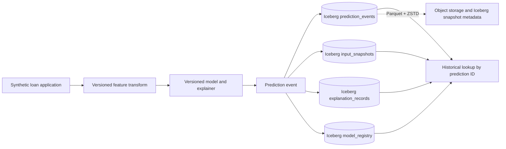

# Explanation Service with an Audit Trail

Big Data Systems and Responsible AI mini project — three-person collaboration across storage design (Person 1), query interface and reproducibility (Person 2), and regulatory compliance and audit trail (Person 3).

## Architecture



## Person 1 deliverables

- [Storage design report (DOCX)](person1_storage_design.docx)
- [Storage design (Markdown)](person1_storage_design.md)
- [Iceberg table DDL proposal](iceberg_schema.sql)
- [Synthetic example records](synthetic_audit_records.json)

## Person 2 deliverables (this branch: `person2/query-interface-reproducibility`)

- [Query interface SQL + monthly batch layout](person2_query_interface/sql/)
- [Query service, reproducibility engine, versioned explainers](person2_query_interface/app/)
- [Data contract](person2_query_interface/contracts/data_contract.md)
- [Synthetic monthly batches (Parquet + ZSTD)](person2_query_interface/data/monthly_batches/)
- [Reproducibility test suite](person2_query_interface/tests/)
- [Performance benchmarks](person2_query_interface/benchmarks/)
- [Person 2 README](person2_query_interface/README.md)

### Person 2 summary

- FastAPI query layer: `GET /explain` (decision by `request_trace_id` + time window), `GET /decision/{id}`, `GET /decision/{id}/at/{snapshot}` (point-in-time), `GET /replay/{id}`, `GET /consistency`.
- SQL queries Q1–Q7 against Person 1's `audit.*` Iceberg tables; DuckDB/Parquet backend prunes monthly batches via `batch_manifest.json` (partition pruning equivalent); same SQL runs on a real Iceberg catalog with `VERSION AS OF`.
- Reproducibility engine replays the pinned model on the stored input and validates score (≤1e-6), exact decision, reason codes, contribution ranking, and input/explanation hashes.
- Versioned explainers: feature_importance / shap / lime at 1.0.0; unknown method/version rejected.
- Pytest suite: 27 passing tests; benchmarks show p95 ≤ ~100 ms at 10k records against the 5-second SLO.

## Design summary

- Four logical Iceberg tables: `prediction_events`, `input_snapshots`, `explanation_records`, and `model_registry`.
- Parquet data files with Zstandard compression; time-based partitions on decision time for events and created time for linked artifacts; monthly partitions are an option for small demonstrations.
- Immutable event and artifact records linked by generated UUIDs, with SHA-256 hashes for canonical inputs and explanations.
- Retain Iceberg snapshots and immutable model, preprocessing, explainer, and policy artifacts to support point-in-time replay.
- Do not partition by applicant or include direct borrower identifiers. Use only synthetic records in this project implementation.

## Data and privacy note

The supplied Lending Club CSV contains borrower-level financial, employment, location, and free-text fields. The course brief prohibits real personal data, so this repo does not contain that CSV or any real borrower values. The included examples are synthetic. `Default` in the source data is a final repayment outcome, not a historical accept/deny decision.

## Status and setup

This is Person 1's architecture submission. The SQL is a proposed Spark SQL / Iceberg schema (`iceberg_schema.sql`). Person 2 uses it as the storage baseline for the query interface and reproducibility test; see `person2_query_interface/`. No dataset download is required — all records are synthetic.

### Iceberg backend (Person 2)

A real Apache Iceberg catalog backend is available via `EXPLANATION_REPO_BACKEND=iceberg`. It reads from an Iceberg warehouse (default: `iceberg_warehouse/`) using a SQL catalog (SQLite) and supports native `VERSION AS OF` time travel.

Initialize and load data:

```bash
python3 init_iceberg.py
```

Run the service with Iceberg:

```bash
EXPLANATION_REPO_BACKEND=iceberg uvicorn person2_query_interface.app.service:app
```

The DuckDB/Parquet backend remains the default (`EXPLANATION_REPO_BACKEND=duckdb`) and requires no cluster.

## Dataset provenance

Suggested source record: [Lending Club loan dataset for granting models, Zenodo 11295916](https://zenodo.org/records/11295916). Confirm the applicable license from an authoritative record before redistribution. The project's privacy requirement takes precedence; synthetic input is used here.
