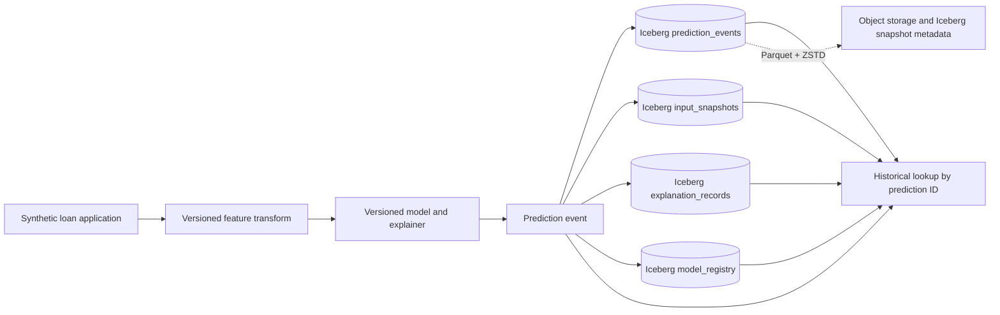

# Explanation Service with an Audit Trail

Person 1 submission for the Big Data Systems and Responsible AI mini project. This repository contains the storage design, Iceberg schema proposal, and synthetic example records.

## Architecture

## Person 1 deliverables

- [Storage design report (DOCX)](docs/person1_storage_design.docx)
- [Storage design (Markdown)](docs/person1_storage_design.md)
- [Iceberg table DDL proposal](schemas/iceberg_schema.sql)
- [Synthetic example records](examples/synthetic_audit_records.json)

## Design summary

- Four Iceberg tables: `prediction_events`, `input_snapshots`, `explanation_records`, and `model_registry`.
- Parquet with Zstandard compression; event tables partition by decision time and linked artifacts by their creation time. Monthly transforms may suit a small demo.
- Immutable events and artifacts link by generated UUIDs, with SHA-256 hashes for canonical inputs and explanations.
- Retain Iceberg snapshots and immutable model, preprocessing, explainer, and policy artifacts for point-in-time replay.
- Do not partition by applicant or include direct borrower identifiers. Use synthetic records only.

## Data and privacy note

The supplied Lending Club CSV contains borrower-level financial, employment, location, and free-text fields. The course brief prohibits real personal data, so this repo does not contain that CSV or real borrower values. Included examples are synthetic. Source field `Default` is a final repayment outcome, not a historical accept/deny decision.

## Status and setup

This is Person 1's architecture submission. The SQL is a proposed Spark SQL / Iceberg schema and has not been applied to a running lakehouse. Person 2 can use it as the storage baseline when implementing the query interface and reproducibility test. To review, open the DOCX or Markdown report; inspect `schemas/iceberg_schema.sql`; use `examples/synthetic_audit_records.json` as a contract fixture. No dataset download is required.

## Dataset provenance

Suggested source record: [Lending Club loan dataset for granting models, Zenodo 11295916](https://zenodo.org/records/11295916). Confirm the applicable license from an authoritative record before redistribution. The project's privacy requirement takes precedence; synthetic input is used here.
